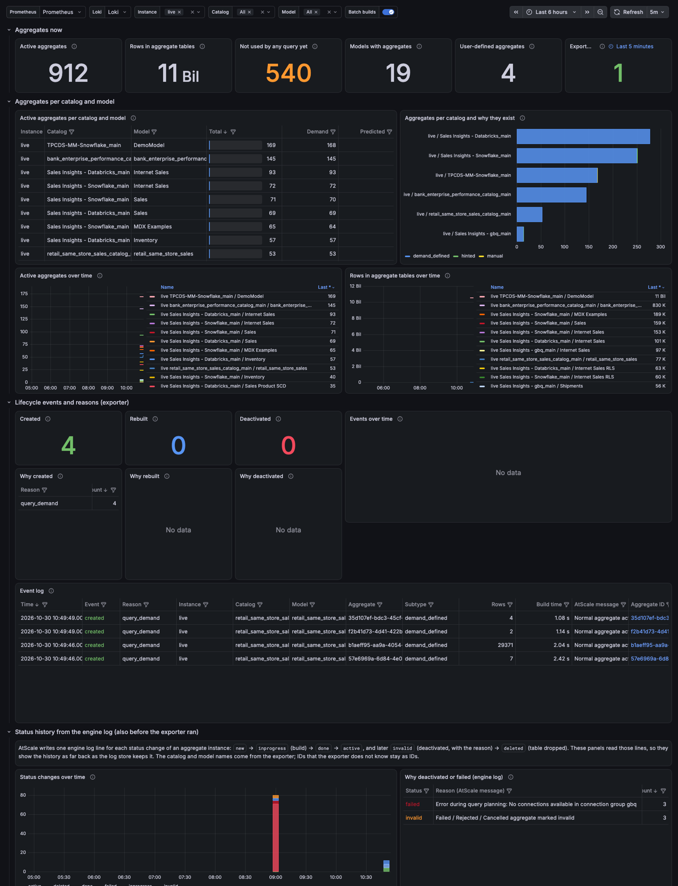
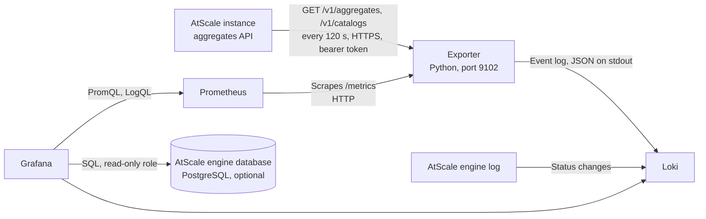

# AtScale aggregate lifecycle monitoring

A Prometheus exporter and a Grafana dashboard that show when AtScale created, rebuilt and deactivated each aggregate, why it did so, and how many aggregates each catalog and model has.

> This is sample code, provided as is under the MIT License. It is not an AtScale product and AtScale does not support it. Read [DISCLAIMER.md](DISCLAIMER.md) before you use it.

AtScale manages aggregate tables on its own: it creates them for queries, rebuilds them in batches and deactivates them when they are unused, broken or over a limit. The exporter turns these changes into events with a reason, and the dashboard combines them with the status history that the AtScale engine writes to its log. An optional section reads AtScale's prediction reports from the engine database and shows why AtScale did not propose an aggregate for a query, or rejected one.



## Contents

- [How it works](#how-it-works)
- [What the dashboard shows](#what-the-dashboard-shows)
- [Why an aggregate changed: the reasons](#why-an-aggregate-changed-the-reasons)
- [Why no aggregate: G and R codes](#why-no-aggregate-g-and-r-codes)
- [Requirements](#requirements)
- [Create the API token](#create-the-api-token)
- [Install on Kubernetes with Helm](#install-on-kubernetes-with-helm)
- [Install on Kubernetes without building an image](#install-on-kubernetes-without-building-an-image)
- [Run with Docker](#run-with-docker)
- [Import the Grafana dashboard](#import-the-grafana-dashboard)
- [Connect the engine database](#connect-the-engine-database)
- [Configuration](#configuration)
- [Metrics](#metrics)
- [Event log](#event-log)
- [Limits](#limits)
- [Run the tests](#run-the-tests)
- [License](#license)

## How it works



The dashboard reads four sources:

| Source | What it gives | Needs |
|---|---|---|
| Exporter metrics in Prometheus | Number of active aggregates per catalog, model and subtype; rows; per-aggregate creation time, last build, build time and query count | Exporter, Prometheus |
| Exporter event log in Loki | One event per created, rebuilt or deactivated aggregate, with catalog and model name and a reason | Exporter, Loki |
| AtScale engine log in Loki | Every status change of every aggregate instance with AtScale's message, and the user query that caused each new aggregate. Covers the time before the exporter ran, as far back as Loki keeps logs | Loki with the engine container log |
| AtScale engine database (optional) | Every prediction decision per user query: the G code when AtScale proposed no aggregate, the R code when it rejected a candidate, with the reason and the settings that decided it | A Grafana PostgreSQL data source with a read-only role |

The exporter polls `GET /v1/aggregates`, which lists the active aggregates. It compares each poll with the one before:

| Event | When | Reason comes from |
|---|---|---|
| `created` | An aggregate ID appears in the active list | The aggregate subtype |
| `rebuilt` | An aggregate gets a new active instance (a new table) | The instance message, the batch ID and the build schedules of the model |
| `deactivated` | An aggregate ID leaves the active list | The status message of its latest instance, from `GET /v1/aggregates/instances` |

The first poll after a start only records the current state, so a restart does not repeat events. The exporter reads aggregate metadata only. It does not export user names or query text.

## What the dashboard shows

The dashboard "AtScale aggregates: lifecycle" has six sections:

| Section | Panels |
|---|---|
| Aggregates now | Active aggregates, rows in aggregate tables, aggregates not used by any query yet, models with aggregates, user-defined aggregates, exporter status |
| Aggregates per catalog and model | Table per catalog and model with demand, predicted and user-defined aggregates; bar chart per catalog by subtype; aggregates and rows over time |
| Lifecycle events and reasons (exporter) | Created, rebuilt and deactivated counts; events over time; why created, why rebuilt, why deactivated; event log table |
| Status history from the engine log | Status changes over time; reasons for deactivations and failed builds; table of every status change; the query that asked for each new aggregate and the attributes the aggregate holds |
| Why AtScale did not propose or rejected an aggregate | Query parts predicted, with an aggregate proposed, not proposed (G), candidates rejected (R); decisions over time; G reasons and R reasons with counts; every decision per query |
| Aggregate inventory | One row per active aggregate: created, last build, build time, rows, queries, last used, table name |

Click an aggregate ID or a query ID in a table to open its full engine log history in Grafana Explore. The "Batch builds" annotation marks the start of each aggregate batch build on the time series.

An aggregate instance moves through these statuses in the engine log: `new`, `inprogress` (build running), `done`, `active` (usable). Later it becomes `invalid` (deactivated, with the reason) and, after a waiting time, `deleted` (table dropped). A build that fails becomes `failed`, with the error as message.

## Why an aggregate changed: the reasons

AtScale stores a reason code for each deactivation, but the public API returns only the status message. The exporter classifies the message into one reason. The engine log panels show the message itself.

Why created (from the subtype):

| Reason | Subtype | Meaning |
|---|---|---|
| `query_demand` | `demand_defined` | A user query had no matching aggregate |
| `prediction` | `prediction_defined` | AtScale predicted the aggregate from the query history |
| `user_defined_in_model` | `hinted` | The aggregate is defined in the model (SML) |
| `user_defined_manual` | `manual` | A user created the aggregate |

Why rebuilt (derived, because AtScale stores no trigger for a build). Each reason ends in `_full` or `_incremental`:

| Reason | Meaning |
|---|---|
| `scheduled_batch_*` | A batch build started up to 30 minutes after a build schedule of the model ran |
| `on_demand_batch_*` | A batch build without a schedule run: API, Design Center or trigger file |
| `query_demand_*` | Built again outside a batch, because a query needed the aggregate after it was deactivated |

Why deactivated (from the status message of the latest instance):

| Reason | AtScale message contains |
|---|---|
| `unused` | "has not been used during the past N days" |
| `aggregate_limit_exceeded` | "Aggregate limit exceeded" |
| `sla_budget_exceeded` | "SLA budget exceeded" |
| `replaced_by_rebuild` | "Deactivated by batch" |
| `removed_by_user` | "Deactivated ... by user" |
| `unreliable` | "Unreliable aggregate" |
| `build_failed` | "Failed / Rejected / Cancelled" |
| `model_changed` | "invalid plan" or "invalid physical plan" |
| `catalog_invalid` | "invalid project" |
| `model_removed` | "unknown cube" |
| `orphaned` | "orphan" |
| `fused` | "Fusing aggregates" |
| `demand_defined_disabled` | "Demand-defined aggregates have been disabled" |
| `user_defined_removed`, `user_defined_changed` | The user-defined aggregate was removed from or changed in the model |
| `table_missing` | "aggregate table ... no longer exists" |
| `connection_removed` | "connection ... was removed" |
| `deleted_no_reason_logged` | "marked Deleted" without an earlier message that names a reason |
| `other`, `unknown` | A message not in this list, or the instances could not be read |

The AtScale settings that drive most deactivations are `aggregates.maintenance.zeroUtilizationTTL` (unused, default 45 days), `aggregates.systemGenerated.activeInstance.retentionLimit` (limit per model, default 100) and `aggregates.invalid.removalAge` (time from `invalid` to `deleted`, default 2 days).

## Why no aggregate: G and R codes

AtScale runs prediction rules for each part of a user query that no aggregate answers. Each rule decision is a prediction report in the engine database (setting `aggregates.prediction.reports.storePredictorData`, default on):

- A G code means that a rule proposed no candidate aggregate.
- An R code means that AtScale proposed a candidate and a rule then rejected it.
- A query part with no G or R code that stops it gets a candidate. AtScale builds it, and the candidate ID becomes the aggregate ID.

Some codes only say that a path does not apply: G260 (always), G270, G300, and G250 when the reason is about preferred store copies. They appear on almost every query. The dashboard hides them unless the variable "Routine codes" is set to `show`.

| Code | Meaning |
|---|---|
| G010 | Dataset does not allow system aggregates |
| G020 | Measures come from more than one dataset |
| G030 | Only dimensional measures, with unrelated dimensions |
| G040 | Dimensional aggregates are off |
| G050 | Query construction not supported for aggregates |
| G060 | A dataset in the query does not allow aggregates |
| G070 | Dimensional aggregate would need narrowing, which is off |
| G080 | Dimension-only query: keys from different datasets |
| G090 | Dimension-only query: hierarchies differ |
| G100 | Dimension-only query: attribute not reachable from all keys |
| G110 | Dimension-only query: several hierarchies, or attribute excluded from aggregates |
| G120 | Key excluded from dimensional aggregates |
| G130 | Table with the attribute values already exists |
| G140 | Table with the key values already exists |
| G150 | Table with the attribute values already exists |
| G160 | Table with the key values already exists |
| G170 | Measures come from different fact tables |
| G190 | Existing aggregate has the same dimensionality |
| G200 | Existing aggregate has the same dimensionality and all measures |
| G210 | Query construction not supported for aggregates |
| G220 | Aggregate basis could not be built for this query part |
| G230 | Exact distinct count or distinct sum, not allowed in aggregates |
| G240 | No compatible HLL or quantile sketches on the warehouse |
| G250 | Measures from several datasets, or no preferred store copy |
| G260 | Not a multi-source query (deprecated path) |
| G270 | No promotion to the preferred store |
| G280 | Query has a dimensional modification without its own aggregate |
| G290 | Aggregates for dimensional modifications are off |
| G300 | No calculated members in the query |
| G310 | Dataset is an aggregate in the preferred store |
| R010 | Filter on a non-additive measure not in the GROUP BY |
| R020 | Identical aggregate already exists |
| R030 | Narrower aggregate does not compress enough |
| R040 | Row security (dynamic constraint) in the selection |
| R045 | Source table has a warehouse row or masking policy |
| R050 | Compression score below threshold, or no statistics |
| R051 | Compression score with slowly changing dimension below threshold |
| R060 | Attribute excluded from dimensional aggregates |
| R070 | Preferred store copy above the per-table row limit |
| R080 | No target warehouse connection for the aggregate |
| R090 | Attribute excluded from fact aggregates |
| R110 | Dataset does not allow the preferred store |
| R120 | Preferred store copy: row count unknown or above the limit |
| R130 | Quantile measures without sketch support |
| R140 | Distinct count estimate measures without sketch support |
| R150 | Preferred store total row limit reached |
| R160 | Calculation type not allowed for a dimensional modification aggregate |
| R170 | Dimensional modification aggregate above the complexity limit |
| R180 | ParallelPeriod inside a range |
| R190 | Decimal without precision for the preferred store |

The settings that decide most rejections are `aggregates.create.compression.threshold` (R030, R050, default 3.0), `aggregates.create.withoutCompressionEstimate.enabled` (R050 without statistics), `aggregate.create.securityDimensions.enabled` (R040) and `aggregates.create.dimensionalModifications.enabled` (G290). The Settings column shows the value that applied.

## Requirements

| Component | Version | Note |
|---|---|---|
| AtScale | Container deployment with the `/v1/aggregates` API | Tested with AtScale 2026.9 |
| Python | 3.12 | In the image (`python:3.12.16-slim`, pinned by digest). Uses only the standard library |
| Prometheus | 2.x or 3.x | Any Prometheus that can scrape the exporter |
| Loki | 2.9 or later | For the event log and the engine log panels. Without Loki, the Prometheus panels still work |
| Grafana | 10 or later | Tested with Grafana 13.2 |
| PostgreSQL access to the AtScale database | Optional | Only for the G and R panels. Tested with the PostgreSQL 16 database of AtScale 2026.9 |
| Helm | 3 or later | Only for the Kubernetes install. Tested with Helm 4.1 |
| Prometheus Operator | Optional | For the `ServiceMonitor`, for example kube-prometheus-stack |

The engine log panels need the log of the AtScale `engine` container in Loki, at log level INFO (the default).

## Create the API token

The exporter calls the AtScale API with a bearer token. The token has the permissions of the user who created it, so use a dedicated service user, not a personal account.

| Permission | Where | Why |
|---|---|---|
| Roles `aggregates_view` and `repository_project_read` | User or group roles | Read the aggregates, their instances and the catalog list |
| Discover on every model you want to monitor | Security settings of each model | AtScale lists an aggregate and a model name only for models the user can access |
| Data warehouse access on every connection those models use | Permissions of each data warehouse connection | AtScale hides a model if the user cannot access all of its connections |
| Optional: access to the aggregate build schedules | `GET /v1/catalogs/{catalogId}/models/{modelId}/aggregates-creation/scheduler` | The three roles above get HTTP 403 here. Without access, rebuilds are reported as `on_demand_batch_*` even when a schedule started them, and the exporter logs one warning |

If a model is missing from the catalog list, the exporter shows its model ID instead of its name.

1. Create a group `atscale-aggregate-monitoring` with the permissions in the table.
2. Create an AtScale user for the exporter, for example `svc-aggregate-monitoring`.
3. Add the user to the group.
4. Log in to Design Center as that user.
5. Open the account menu and create an API token.
6. Store the token in your secret store. Do not commit it.
7. Run `curl -s -H "Authorization: Bearer $TOKEN" "https://atscale.example.com/v1/aggregates?size=1"`.

   Result: the response has a `data` list and a `total` count.

## Install on Kubernetes with Helm

1. Run `docker build -t registry.example.com/atscale-aggregates-exporter:0.1.0 exporter/`.
2. Run `docker push registry.example.com/atscale-aggregates-exporter:0.1.0`.
3. Create the token Secret. Use one key per instance, named `ATSCALE_TOKEN_<NAME>`:

   ```bash
   kubectl create secret generic atscale-aggregates-exporter -n monitoring \
     --from-literal=ATSCALE_TOKEN_PROD="$TOKEN"
   ```

4. Write a values file `my-values.yaml`:

   ```yaml
   image:
     repository: registry.example.com/atscale-aggregates-exporter
   instances:
     - name: prod
       url: https://atscale.example.com
   existingSecret: atscale-aggregates-exporter
   serviceMonitor:
     enabled: true
     labels: {release: kube-prometheus-stack}   # match your Prometheus serviceMonitorSelector
   dashboard:
     enabled: true                              # ConfigMap for the Grafana sidecar
   ```

5. Run `helm upgrade --install atscale-aggregates-monitoring deploy/helm/atscale-aggregates-monitoring -n monitoring -f my-values.yaml`.
6. Run `kubectl logs -n monitoring deploy/atscale-aggregates-monitoring`.

   Result: the log shows `prod: warm-up, N active aggregates recorded without events`, then `prod: N active aggregates, M events` every 120 seconds.

If the exporter runs in the same cluster as AtScale, it can call the sml-api service directly. Then set `url: http://<atscale-release>-sml-api.<atscale-namespace>.svc.cluster.local:3001`, `apiPrefix: /v1/public` and `allowInsecureHttp: true`. The token then travels unencrypted inside the cluster.

If AtScale uses a private or self-signed certificate, put the CA certificate in a ConfigMap and set `caBundle.configMap`. The exporter always checks certificates.

## Install on Kubernetes without building an image

[deploy/kubernetes/manifest.yaml](deploy/kubernetes/manifest.yaml) runs `exporter.py` from a ConfigMap on the pinned Python image, so you need no own image registry.

1. Edit `ATSCALE_INSTANCES`, the namespace and the `ServiceMonitor` label in `deploy/kubernetes/manifest.yaml`.
2. Create the token Secret `atscale-aggregates-exporter` as in step 3 of the Helm install.
3. Run `kubectl create configmap atscale-aggregates-exporter -n monitoring --from-file=exporter/exporter.py`.
4. Run `kubectl apply -f deploy/kubernetes/manifest.yaml`.
5. Run `kubectl logs -n monitoring deploy/atscale-aggregates-exporter`.

   Result: the log shows the warm-up line for each instance.

After an update of `exporter.py`, replace the ConfigMap and run `kubectl rollout restart deploy/atscale-aggregates-exporter -n monitoring`.

## Run with Docker

1. Run `docker build -t atscale-aggregates-exporter:0.1.0 exporter/`.
2. Copy `deploy/docker/exporter.env.example` to `exporter.env`.
3. Set `ATSCALE_INSTANCES` and the `ATSCALE_TOKEN_<NAME>` values in `exporter.env`.
4. Run `docker run -d --name atscale-aggregates-exporter --env-file exporter.env -p 9102:9102 atscale-aggregates-exporter:0.1.0`.
5. Add the job in `deploy/docker/prometheus-scrape.yaml` to your `prometheus.yml`.
6. Configure your log shipper to send the container's stdout to Loki.
7. Run `curl -s localhost:9102/metrics | grep atscale_aggregates`.

   Result: one `atscale_aggregates` line per catalog, model and subtype.

## Import the Grafana dashboard

With the Helm chart, set `dashboard.enabled: true`. The Grafana sidecar loads the ConfigMap.

Without the Helm chart:

1. Open Grafana and select Dashboards, New, Import.
2. Upload `dashboard/atscale-aggregates-lifecycle.json`.
3. Select your Prometheus and Loki data sources in the variables at the top.
4. If your log labels differ, open Dashboard settings, Variables, and edit the two hidden variables:
   - `event_selector`: the Loki stream of the exporter, default `{container="aggregates-exporter"}`.
   - `engine_selector`: the Loki stream of the AtScale engine, default `{container="engine"}`. Add a namespace label if you run more than one AtScale instance, for example `{container="engine",namespace="atscale"}`.

The dashboard JSON is generated. To change a panel, edit `dashboard/generate.py` and run `python3 dashboard/generate.py`. It writes the dashboard and the copy in the Helm chart.

## Connect the engine database

This step is optional. Without it, the section "Why AtScale did not propose or rejected an aggregate" stays empty and the other panels still work. Do it once per AtScale instance.

> Caution: the panels read internal AtScale tables (`engine.queries`, `engine.queries_planned`, `engine.aggregate_prediction_reports`). A later AtScale release can change them. Use a read-only role, never the database owner.

1. Generate a password and keep it in your secret store.
2. Create the read-only role as the database owner. On Kubernetes, the database is the pod `atscale-db-0`, container `postgres`, database `atscale`:

   ```bash
   { printf '\\set reader_password %s\n' "$PASSWORD"; cat deploy/postgres/grafana-reader.sql; } \
     | kubectl -n <atscale-namespace> exec -i atscale-db-0 -c postgres -- psql -U postgres -d atscale -f -
   ```

   Result: role `grafana_reader` can read the three tables and nothing else. Its transactions are read-only, statements stop after 30 s, and it has at most 5 connections. Run the script again to change the password.
3. Add a PostgreSQL data source in Grafana: host `atscale-db.<atscale-namespace>.svc.cluster.local:10518`, database `atscale`, user `grafana_reader`, TLS off inside the cluster. Set "Max open connections" to 2.
4. In the dashboard, select the data source in "Engine database".

Result: the four counts at the top of the section show numbers for the selected time range.

The "Engine database" variable selects one instance at a time. Select the data source that belongs to the instance in "Instance". Catalog and model filters use the IDs from the exporter, so they work only for models that the exporter's token can read.

## Configuration

All settings are environment variables. The Helm chart sets them from `values.yaml`.

| Variable | Default | Meaning |
|---|---|---|
| `ATSCALE_INSTANCES` | required | Comma list of `name=url`, for example `prod=https://atscale.example.com,dev=https://atscale-dev.example.com`. The name becomes the `env` label |
| `ATSCALE_TOKEN_<NAME>` | required | API token per instance. `NAME` is the instance name in upper case, other characters as `_` |
| `API_PREFIX` | `/v1` | `/v1/public` when the URL is the sml-api service inside Kubernetes |
| `POLL_SECONDS` | `120` | Time between polls. A full poll reads all active aggregates, 100 per request |
| `AGGREGATE_DETAILS` | `true` | Per-aggregate gauges. Set `false` above about 20,000 active aggregates to keep Prometheus small |
| `SCHEDULES` | `true` | Read the build schedules to tell scheduled from on-demand rebuilds |
| `EVENT_LOG` | `true` | One JSON line per event on stdout |
| `CA_BUNDLE` | none | PEM file with extra CA certificates |
| `ALLOW_INSECURE_HTTP` | `false` | Allow `http://` URLs, only for the sml-api service inside the cluster |
| `CATALOG_CACHE_MINUTES` | `10` | How long the catalog and model names are reused |
| `PAGE_SIZE`, `MAX_PAGES` | `100`, `200` | Paging of the aggregates API. The API returns at most 100 rows per page |
| `HTTP_TIMEOUT_SECONDS`, `MAX_RESPONSE_MB` | `30`, `20` | Limits per request |
| `PORT`, `BIND_ADDRESS` | `9102`, `0.0.0.0` | Address of `/metrics` and `/healthz` |

Run exactly one replica: two replicas log every event twice.

## Metrics

| Metric | Type | Labels | Meaning |
|---|---|---|---|
| `atscale_aggregates` | gauge | `env`, `catalog`, `model`, `subtype`, `type` | Active aggregates |
| `atscale_aggregate_rows_total` | gauge | same | Rows in the active aggregate tables |
| `atscale_aggregates_unused` | gauge | same | Active aggregates that no query has used yet |
| `atscale_aggregate_events_total` | counter | `env`, `catalog`, `model`, `event`, `reason`, `subtype` | Lifecycle events since the exporter started |
| `atscale_model_info` | gauge | `env`, `catalog_id`, `catalog`, `model_id`, `model` | 1 per model; maps IDs in the engine log to names |
| `atscale_aggregate_created_timestamp_seconds` | gauge | `env`, `catalog`, `model`, `aggregate_id`, `aggregate`, `subtype`, `table` | When AtScale created the aggregate |
| `atscale_aggregate_built_timestamp_seconds` | gauge | same | When the build of the active table finished |
| `atscale_aggregate_build_duration_seconds` | gauge | same | Build time of the active table |
| `atscale_aggregate_rows` | gauge | same | Rows in the active table |
| `atscale_aggregate_queries` | gauge | same | Queries that used the aggregate |
| `atscale_aggregate_last_query_timestamp_seconds` | gauge | same | When a query last used the aggregate (0 = never) |
| `atscale_aggregates_exporter_up` | gauge | `env` | 1 if the last poll succeeded |
| `atscale_aggregates_exporter_last_success_timestamp_seconds` | gauge | `env` | Time of the last successful poll |
| `atscale_aggregates_exporter_poll_errors_total` | counter | `env` | Failed polls |

A new series of `atscale_aggregate_events_total` starts at 0 and gets its first event one poll later, so that PromQL `increase()` counts that event. Use it for alerts, for example on `reason="build_failed"`.

## Event log

With `EVENT_LOG=true`, the exporter writes one JSON line per event to stdout:

```json
{"action": "deactivated", "aggregate": "9cc6492e-...", "aggregate_id": "9cc6492e-...", "catalog": "sales_catalog",
 "event": "atscale_aggregate", "env": "prod", "message": "Aggregate has not been used during the past 45 days",
 "model": "Sales", "reason": "unused", "status": "invalid", "subtype": "demand_defined", "time": "2026-10-30T10:00:00Z"}
```

`time` is the creation time for `created`, the end of the build for `rebuilt`, and the time the exporter saw the change for `deactivated`. Other fields: `catalog_id`, `model_id`, `instance_id`, `batch_id`, `table`, `rows`, `build_ms`, `build_query_id`, `incremental`, `type`.

## Limits

- The public API lists active aggregates only. A deactivation is seen at the next poll, so its time is accurate to `POLL_SECONDS`.
- An aggregate that is created and deactivated between two polls produces no exporter event. The engine log panels still show it.
- AtScale stores no trigger for a rebuild. The exporter derives scheduled or on-demand from the build schedules; a trigger file and an API call both count as on demand.
- The reasons are classified from AtScale's English status messages. A message that a later AtScale release changes shows as `other`. The message itself is always in the event.
- Some engine log lines name the catalog but not the model. The status table then shows "(not in the log line)" as model.
- The engine log panels reach back as far as your Loki retention.
- The prediction panels reach back as far as AtScale keeps query history in its database. They read internal tables, so an AtScale upgrade can break them.
- Compound rules write a second row under their own name (for example `GenerateDimensionallyModifiedAggCandidates` repeats R160). The panels read only `G###` and `R###` codes, so these rows are not counted twice.
- The exporter keeps its state in memory. Events that happen while it is down are not reported as events, but the counts are correct again after the next poll.

## Run the tests

1. Run `cd exporter`.
2. Run `python3 -m unittest test_exporter.py`.

   Result: `OK`. The tests use a fake API and need no AtScale instance.

## License

MIT License, see [LICENSE](LICENSE). Read [DISCLAIMER.md](DISCLAIMER.md): this is sample code without support or warranty.
